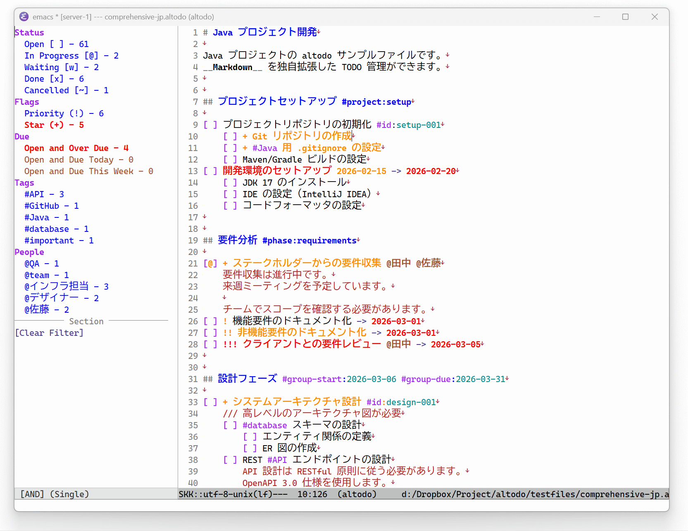

# altodo - TODO text file format, and Emacs Major Mode Package

[English README.md](README_en.md) / [変更履歴](CHANGELOG.md)

-----



このレポジトリは、__altodo__ フォーマットの仕様、および altodo を便利に管理する Emacs Major Mode 用のパッケージ __altodo.el__ を配布する。

- __altodo__ フォーマット: Markdown（CommonMark） ファイル上に埋め込み可能な TODO フォーマット
    - altodo フォーマット仕様（独自拡張部分）には MIT ライセンスが適用される
- __altodo.el__: Emacs 上で altodo フォーマットの TODO を管理する Emacs Lisp パッケージ
    - GNU General Public License v3.0 が適用される


## altodo フォーマットについて

__altodo__ は __Markdown__ および __CommonMark__ フォーマット仕様の独自拡張である。なお altodo は Creative Commons CC0 1.0 Universal でライセンスされた __[x]it!__ https://xit.jotaen.net/ を一部ベースにし、参考にした。

詳細は doc/altodo_spec.md を参照すること。

- Markdown（CommonMark） の独自拡張としてのテキストフォーマット仕様
    - altodo のフォーマット以外は Markdown（CommonMark） のフォーマット仕様に従う
- TODO は無限にネスト可能
- 1 行および複数行コメントを表現可
- タグ、スター、優先度、開始日・期日、依存関係タグを付与可

特徴は、TODO を Markdown 内に埋め込めること、プレーンテキストであること、無限にネストできること、複数行のコメントを付与できることである。
エディタの表示支援がなくても読める、単純な TODO フォーマットである。


### サンプル

```markdown
# altodo は Markdown 内に記載のできる TODO フォーマットである

前後がタスク行でなければ、 __通常の Markdown (CommonMark) 同様のテキスト__ を記載できる。

[ ] ここから TODO 行
[ ] __太字__ ~~斜線~~ のように、インラインの `Markdown` 記法をタスク内に埋め込める
[x] ここまで TODO 行

TODO 行、およびコメント行以外は通常の Markdown (CommonMark) のフォーマットである。


# 見出しにも #tag を埋め込むことができる

## altodo ファイル例 #tag

以下、altodo フォーマットのタスクを記載したものである。

[@] 進行中のタスク
    /// シングルコメント行
    [ ] 子タスク A（ネストのスペースは通常 4 文字）
        [x] 完了した子タスク
            [~] 廃止したタスク
    [w] 待機タスク @JohnDoe が対応中
[ ] + スターの付いたタスク
    [ ] ! 優先度の高いタスク
        [ ] !! さらに優先度の高いタスク
            [ ] !!! 最も優先度の高いタスク
[ ] タスク
    複数行コメント 1 行目
    複数行コメント 2 行目
    [ ] ネストされたタスク A
        ネストされたタスク A の複数行コメント 1 行目
        ネストされたタスク A の複数行コメント 2 行目
        
        インデントと同じ数のスペースだけの行も、複数行コメントの続き（複数行コメント 4 行目）
[ ] タグの付いたタスク #home タグの前後は半角スペースを入れる
[ ] 開始日があるタスク 2025-01-01 -> から開始
    [ ] 期限のあるタスク -> 2025-12-31 までに完了させる
    [ ] 開始日と期限があるタスク 2025-02-01 -> 2025-03-31 内に対応する
[ ] key-value 型のタグのあるタスク #key:value
[ ] 特殊なタグ（id）を使用した依存関係のあるタスク（ユニークの ID を持つ） #id:20250101-0000
[ ] 特殊なタグ（dep）を利用した依存関係のあるタスク（依存先 ID を指定） #dep:20250101-0000
[ ] 依存関係のあるタスク 2（依存先 ID を指定）  #dep:20250101-0000
[ ] 人 @JohnDoe や場所 @home を @person タグで表わすことができる
```


### 主要構文

#### タスク管理

- `[ ]`: オープン
- `[x]`: 完了（自動で #done タグ追加）
- `[@]`: 進行中
- `[w]`: 待機
- `[~]`: キャンセル


#### コメント

- `/// コメント`: 1 行コメント。タスクの一部ではない、分離した注記（補足、レビューメモ）
- 複数行コメント: タスク行・1 行コメントのインデント + 4 つのスペースの行。タスクの説明など、タスクの一部
    - 開始の行のインデントは、前行 + 4 スペースのみ。同じインデントの行や、+ 8 スペースの行は複数行コメントにならない
    - 完全な空行（0 文字）、およびインデントが異なる行で終了する


#### フラグ

- `!`, `!!`, `!!!`: 優先度（仕様上は無制限であるが通常 3 段階まで。 ! が多いほど優先度が高い）
- `+` - スターフラグ。優先度と併用できる（`+ !! タスク`、`!! + タスク`）
- 1 行コメント（`/// ! 注記`）にも付与できる


#### タグ

- `#tag`: 一般タグ
- `#tag:value`: 値付きタグ
- `@person`: 担当者・場所タグ（例: `@smith`, `@名無しさん`, `@company`）


#### 特殊タグ

- `#id:value`: ID タグ
- `#dep:value`: 依存関係タグ。 ID タグの value を指定する
- `#done:timestamp`: 完了・廃止された時刻（アプリケーションが自動で付与する）
- `#seq-tasks`: 子タスクを上から順に実行する（直前の兄弟タスクが完了・廃止されるまで、次のタスクは実行できない）
- `#group-start:date`、`#group-due:date`: 親タスクに付けて、グループ（親タスクと子孫）全体の開始日・期日を表す。子タスクごとに書かず、親に 1 回書く

`#`、`@`、`->` をそのまま記載するエスケープは、現在サポートしていない（`doc/altodo_spec.md` の 3.7 を参照）。


#### 期日・開始日

- `-> YYYY-MM-DD`: 期日
- `YYYY-MM-DD ->`: 開始日
- `YYYY-MM-DD -> YYYY-MM-DD`: 開始日と期日


## altodo.el

Emacs 上で altodo フォーマットの TODO を管理する Emacs Lisp パッケージである。 __Emacs Markdown Mode__ https://github.com/jrblevin/markdown-mode の独自拡張とし、altodo ファイルを操作し、face 適用やフィルタリングなどの機能でタスクを閲覧・操作しやすくする。
詳細は doc/design.md を参照すること。

- タスクの状態、フラグ、タグ、日付の色付け（face）、キーバインド、各種コマンド
- フィルタと、フィルタに一致するタスクの件数を表示するサイドバー。複数のフィルタを選ぶと、組み合わせた件数に更新する
    - サイドバーの内容は自由にカスタマイズ可能

処理速度を重視し、数千行の TODO を扱えるようにしている。フィルタの処理時間の目安は、5000 行のバッファで 1 秒以内である（`scripts/bench-filter.sh` で測定する）。
フィルタの条件は、DSL パターンで書ける。lambda 式を使う場合は、predicate 関数を利用できる。


### インストール

- Emacs 29.1 以上（Emacs 29.3 で動作を確認している）
- markdown-mode 2.6 以上の導入（`Package-Requires` も 2.6 以上。2.6 で動作を確認している）
    - 導入手順は、[markdown-mode の README](https://github.com/jrblevin/markdown-mode) の「Installation」に従う。そこでは MELPA Stable を推奨している
    - `M-x package-install RET markdown-mode RET`（パッケージのアーカイブに MELPA Stable を追加した後）

```elisp
(require 'package)
(add-to-list 'package-archives
             '("melpa-stable" . "https://stable.melpa.org/packages/"))
(package-initialize)
```


altodo.el を任意のディレクトリに配置し、以下のように init.el に追加する。

```
cp ./altodo.el ./altodo-calendar.el ~/.emacs.d/lisp/.
```

```elisp
(add-to-list 'load-path "~/.emacs.d/lisp/")
(require 'altodo)
(add-to-list 'auto-mode-alist '("\\.altodo\\'" . altodo-mode))
```


#### 使用開始

1. `.altodo` ファイルを作成または開く
2. `M-x altodo-mode` で altodo-mode を有効化
3. `M-x altodo-sidebar-show` でサイドバーを表示
4. キーバインドでタスクを管理


### キーバインド

altodo-mode は markdown-mode を継承しているため、markdown-mode のキーバインドも使用できる。altodo のキーは、有効な行が決まっている。有効でない行では、markdown-mode の同じキーの割り当てになる。

- タスク行: タスク操作のキー、`C-c C-t d`、`C-c C-t D`
- タスク行・1 行コメント行: フラグ操作、日付の入力、タスクの追加、`C-c C-i`、`C-c C-j`
- タスク行・1 行コメント行・複数行コメント行: `M-<right>`、`M-<left>`
- 全ての行: `TAB`、`RET`、`S-TAB`、サイドバーとフィルタのキー（`C-c C-v` で始まるキー）


#### タスク操作

- `C-c C-x`: タスク状態トグル（オープン `[ ]` ⇔ 完了 `[x]`）
- `C-c C-t o`: オープンに設定
- `C-c C-t x`: 完了に設定
- `C-c C-t @`: 進行中に設定
- `C-c C-t w`: 待機に設定
- `C-c C-t ~`: キャンセルに設定


#### フラグ操作

- `C-c C-s`: スターフラグトグル
- `C-c C-f 1`: 優先度 1 に設定（既に優先度 1 のときは優先度を外す）
- `C-c C-f 2`: 優先度 2 に設定（既に優先度 2 のときは優先度を外す）
- `C-c C-f 3`: 優先度 3 に設定（既に優先度 3 のときは優先度を外す）
- `C-c C-i`: ID タグを挿入（`#id:value` 形式）


#### 日付の入力

カーソルのタスク行（または `///` 行）に、期日（`-> DATE`）や開始日（`DATE ->`）を入力する。日付は `altodo-date-format` の書式で書く。既にある同じ種類の日付は、置き換える。

- `C-c C-e d`: カレンダーのウィンドウで期日を選ぶ（`altodo-select-due-calendar`）
- `C-c C-e s`: カレンダーのウィンドウで開始日を選ぶ（`altodo-select-start-calendar`）
- `M-x altodo-input-due-date`: ミニバッファで期日を入力する
- `M-x altodo-input-start-date`: ミニバッファで開始日を入力する

カレンダーのウィンドウでは、日付に移動して `RET` で確定し、`q` で中止する。週の開始日は `altodo-week-start-day` に従う。カーソルは、既にある日付の位置から始まる。期日と開始日の両方があるときは、`DATE -> DATE` のように矢印を共有する。


#### タスクの追加

- `RET`: 文脈に応じた改行
    - タスク行・`///` 行: 行内の位置に関わらず、そのタスクの複数行コメント・子タスクの後ろに、同じインデントの新しいタスクを追加する（行の途中で分割しない）
    - 空のタスク行（`[ ] ` だけ）: マーカーを消してリストを終える
    - 複数行コメント行: 同じインデントで次の行に続ける
- `C-c C-a`: タスクを追加（そのタスクの複数行コメント・子タスクの後ろに、同じインデントで追加する）
- `M-RET`: サブタスクを追加（最後の子として、1 段深いインデントで追加する）
- `C-c C-m`: 複数行コメントを開始


#### インデント（ネスト）操作

- `TAB`: スマートインデント
- `M-<right>`: インデント増加
- `M-<left>`: インデント減少
    - タスク行・`///` 行では、その行の複数行コメントも一緒に動く。子タスクは動かさない


#### その他

- `S-TAB`: アウトラインサイクル
- `C-c C-t d`: done タスクを done ファイルに移動（子孫ごと）
- `C-c C-t D`: done タスクの行だけを done ファイルに移動（子タスクは残る）
- `C-c C-j`: 依存タスクにジャンプ（`#dep:xxx` → `#id:xxx`）
- `M-x altodo-sidebar-show`: サイドバーを表示
- `M-x altodo-sidebar-hide`: サイドバーを非表示
- `M-x altodo-sidebar-toggle`: サイドバーをトグル
- `C-c C-v s t`: サイドバーの表示切替
- `C-c C-v s r`: サイドバーを更新
- `C-c C-v f c`: フィルタをクリア


#### サイドバー操作（サイドバー内）

- `RET`、`SPC`: フィルタを適用
- `s`: フィルタを選択/解除（複数選択）
- `c`: フィルタをクリア
- `r`: サイドバーを更新
- `q`: サイドバーを閉じる
- `?`、`h`: キーバインドのヘルプを表示
- `}`、`{`、`.`: カレンダーの次の月、前の月、今月
- `n`、`p`: 次の行、前の行へ移動
- `C-c C-a`: AND モードに切り替え
- `C-c C-o`: OR モードに切り替え
- `C-c C-t`: AND/OR をトグル
- `Ctrl+マウス左ボタン`: マウスでフィルタを選択/解除


### done タスク移動機能

完了（`[x]`）またはキャンセル（`[~]`）されたタスクを別ファイルに自動移動する機能。
既定では、タスクと、その子孫（子タスク、`///` 行、複数行コメント）を、まとめて移動する（サブツリーの単位）。見出し（heading）ごとにグループ化する。


#### 基本機能

- 手動移動: `C-c C-t d` でカーソル位置のタスクを、子孫ごと移動
- 1 つだけ移動: `C-c C-t D` でカーソル位置のタスクの行（と複数行コメント）だけを移動。子タスクは元の場所に残る
- バッファ全体移動: `M-x altodo-move-all-done-tasks` でバッファ内の全 done タスクを移動
- 自動移動タイマー: 定期的に全バッファの done タスクを自動移動


#### 移動の単位

`altodo-move-unit` で、移動の単位を選ぶ。

- `subtree`（既定）: 完了・廃止のタスクを、子孫ごと移動する。子孫に未完了のタスクがあるときは、移動しない（手動ではエラー、一括・自動では飛ばす）。一括移動と自動移動は、親のないタスクだけを対象にする。完了した子は、親が完了して、サブツリー全体が完了するまで、移動しない。手動の移動（`C-c C-t d`）は、親が未完了でも、その子のサブツリーを移動できる
- `line`: タスクの行と複数行コメントだけを移動する。子タスクは元の場所に残り、完了した子は、親から離れて移動する

done ファイルには、移動したサブツリーの根をインデント 0 に揃えて書く。子孫の相対インデントは保つ。`C-c C-t D`（`M-x altodo-move-done-task-alone`）は、`altodo-move-unit` によらず、`line` の単位で移動する。


#### 移動までの日数

`altodo-move-after-days` に日数 N を指定すると、一括移動（`M-x altodo-move-all-done-tasks`）と自動移動は、`#done` タグの日付が N 日以上前のタスクだけを移動する。手動の移動（`C-c C-t d`、`C-c C-t D`）には適用しない。

- `#done` の値は、ISO 8601 の日付・日時（日付の部分を使う）、Unix 時間（秒）、`altodo-date-format` の日付を読む
- `#done` タグがない、または日付として読めないタスクは、移動しない
- タイムゾーン: `#done` の日付は、書かれた時刻のタイムゾーンの日付である。今日の日付は、ローカルタイムゾーンで数える。`altodo-use-local-timezone` を `nil`（UTC で記録）にしていると、`#done` の日付がローカルの日付と最大 1 日ずれ、N 日の判定に最大 1 日の誤差が出る。ISO 8601 の値の時差（`+09:00` など）は、日付の判定に使わない
- 移動の単位が `subtree` のときは、サブツリーの全てのタスクが条件を満たす必要がある。`line` のときは、そのタスクだけを調べる


#### done ファイル

- done タスクは `{元のファイル名}_done.altodo` に移動
- 見出し（セクション）ごとにグループ化
- マルチラインコメントも一緒に移動
- 空行は保持
- 次の場合は、何も移動せずエラーにする: バッファが読み取り専用、done ファイルが書き込めない（ディレクトリである、親ディレクトリに書き込めない）
- done ファイルを開いているバッファがある場合は、そのバッファに追記する。未保存の変更がなければ保存し、あれば保存せずメッセージで知らせる
- 自動移動で、あるバッファの移動に失敗した場合は、メッセージを表示し、他のバッファの移動を続ける。読み取り専用のバッファは、移動せずメッセージを表示する


#### 自動移動タイマー

タイマーは、自動では開始しない。次のコマンドで開始する（Emacs を再起動すると停止する）。

```elisp
;; タイマーを開始/停止（toggle）
M-x altodo-toggle-auto-move-timer

;; または個別に
M-x altodo-start-auto-move-timer
M-x altodo-stop-auto-move-timer

;; 実行間隔を変更（デフォルト: 3600 秒 = 1 時間。正の数）
(setq altodo-auto-move-interval 1800)  ; 30 分

;; 自動保存を有効化（デフォルト: nil）
(setq altodo-auto-save-after-move t)

;; #done から 7 日以上が過ぎたタスクだけを移動（デフォルト: nil = すぐに移動）
(setq altodo-move-after-days 7)

;; done ファイルをスキップ（デフォルト: t）
(setq altodo-auto-move-skip-done-files t)

;; モードライン表示（デフォルト: t）
(setq altodo-show-auto-move-in-mode-line t)
```


#### done ファイルのカスタマイズ

```elisp
;; done ファイル名に付ける文字列を変更（デフォルト: "_done"）
;; 変数名は prefix だが、文字列は元のファイル名の後ろに付く（notes.altodo → notes_archive.altodo）
(setq altodo-done-file-prefix "_archive")
```


### 設定

#### 基本設定

| 変数名                                         | 説明                                                                                  | デフォルト値 |
| ---------------------------------------------- | ------------------------------------------------------------------------------------- | ------------ |
| `altodo-indent-size`                           | インデントサイズ（スペース数）                                                        | `4`          |
| `altodo-enable-markdown-in-multiline-comments` | 複数行コメント内で Markdown フォーマットを有効化                                      | `t`          |
| `altodo-auto-save`                             | タスク状態変更時にファイルを自動保存                                                  | `nil`        |
| `altodo-skk-wrap-newline`                      | SKK 入力メソッドとの互換性のため改行をラップ                                          | `t`          |
| `altodo-inline-code-cache`                     | 色付けでインラインコードの探索結果を再利用する（`nil` で markdown-mode の探索のまま） | `t`          |


#### サイドバー設定

| 変数名                                  | 説明                                                    | デフォルト値 |
| --------------------------------------- | ------------------------------------------------------- | ------------ |
| `altodo-sidebar-modeline-enabled`       | サイドバーにフィルタ状態を表示                          | `t`          |
| `altodo-sidebar-dynamic-count-enabled`  | 複数フィルタ選択時にカウントを動的に更新                | `t`          |
| `altodo-sidebar-position`               | サイドバー表示位置（`left`、`right`、`above`、`below`） | `'left`      |
| `altodo-sidebar-size`                   | 幅（左右）・高さ（上下）。1 未満は比率、1 以上は桁・行  | `0.2`        |
| `altodo-sidebar-indent`                 | サイドバーインデント幅                                  | `2`          |
| `altodo-sidebar-focus-after-activation` | フィルタの適用後にソースのウィンドウへフォーカスを移す  | `nil`        |
| `altodo-sidebar-hide-mode-line`         | サイドバーのモードラインを非表示                        | `nil`        |
| `altodo-sidebar-hide-line-numbers`      | サイドバーの行番号を非表示                              | `t`          |
| `altodo-locals-code-policy`             | `.altodo-locals.el` のコードの実行方針                  | `'deny`      |
| `altodo-trusted-locals`                 | 承認した `.altodo-locals.el` の SHA-256                 | `nil`        |


#### サイドバーの動作

- 更新: 保存時（サイドバーが表示されているとき）と、`r`、`C-c C-v s r` で更新する。編集しただけでは、件数は変わらない
- 複数選択: `s` で選べるのは、`search-simple` と `search-lambda` のエントリである。AND のとき、件数は選んだ条件を重ねた値になる。OR のとき、件数は各エントリ単独の値のままである。動的フィルタ（タグ、担当者など）の一覧は、AND、OR とも、選んだ条件に一致する行から集める。`altodo-sidebar-dynamic-count-enabled` が `nil` のときは、常に全体の件数を表示する
- AND/OR の切り替え: モードラインの `[AND]`、`[OR]` のクリックと `C-c C-t` は、選択を残して絞り込み直す
- 描画できないエントリ: 値が不正なエントリは、メッセージを 1 回表示して除く。他のエントリは描画する


#### フィルタのコマンド

サイドバーを使わずに絞り込むコマンドである。実行すると、サイドバーの選択は解除される。

- `M-x altodo-filter-by-pattern`: DSL パターンに一致する行だけを表示する（例: `and:open,priority`）
- `M-x altodo-filter-show-done-only`、`-progress-only`、`-waiting-only`、`-open-only`、`-cancelled-only`: 状態で絞り込む
- `M-x altodo-filter-show-priority`、`altodo-filter-show-star`: フラグで絞り込む
- `M-x altodo-filter-show-tag`、`altodo-filter-show-person`: タグ、担当者で絞り込む
- `M-x altodo-filter-show-overdue`: 期限が過ぎた、完了・廃止でないタスクを表示する


#### 日付・ID 設定

| 変数名                            | 説明                                   | デフォルト値   |
| --------------------------------- | -------------------------------------- | -------------- |
| `altodo-date-format`              | 日付フォーマット（nil で ISO 8601）    | `nil`          |
| `altodo-week-start-day`           | 週の開始日（0=日曜日, 1=月曜日）       | `0`            |
| `altodo-done-tag-datetime-format` | #done タグのタイムスタンプ形式         | `nil`          |
| `altodo-use-local-timezone`       | #done タグにローカルタイムゾーンを使用 | `t`            |
| `altodo-insert-id-format`         | #id: タグの ID 形式                    | `'tiny-random` |


##### `altodo-date-format`

日付表示フォーマット。`nil` の場合は ISO 8601 形式（`YYYY-MM-DD`）。

**例**:
```elisp
(setq altodo-date-format "%Y/%m/%d")      ;; 2026/01/15
(setq altodo-date-format "%Y年%m月%d日")  ;; 2026年01月15日
(setq altodo-date-format nil)             ;; 2026-01-15 (ISO 8601)
```


##### `altodo-done-tag-datetime-format`

`#done:TIMESTAMP` タグのタイムスタンプ形式。`nil` の場合は ISO 8601 形式（`YYYY-MM-DDTHH:MM:SS+HH:MM`）。

**例**:
```elisp
(setq altodo-done-tag-datetime-format "%Y-%m-%d %H:%M:%S")  ;; 2026-01-15 14:30:00
(setq altodo-done-tag-datetime-format nil)                  ;; 2026-01-15T14:30:00+09:00
```


##### `altodo-insert-id-format`

`C-c C-i` で挿入する ID タグの形式。

**オプション**:
- `'tiny-random`: ランダム部が先頭の最大 10 文字（デフォルト。先頭の 0 を省くため、8〜10 文字になる）
- `'tiny`: 時刻部が先頭の 10 文字（時刻順にソート可能）
- `'short-random`: ランダム部が先頭の最大 16 文字（14〜16 文字になる）
- `'short`: 時刻部が先頭の 15 文字（時刻順にソート可能）
- `'base62`: UUID v7 を Base62 で表記した 21 文字
- `'uuid`: UUID v7（RFC 9562。先頭 48 ビットがミリ秒の Unix 時刻）の 36 文字

**例**:
```elisp
(setq altodo-insert-id-format 'tiny-random)      ;; 6WJT2C47gz
(setq altodo-insert-id-format 'tiny)             ;; 2C47gz6WJT
(setq altodo-insert-id-format 'uuid)             ;; 01a167b2-1ffe-76ae-900f-81590d270596
```


#### タスク移動設定

| 変数名                               | 説明                                             | デフォルト値 |
| ------------------------------------ | ------------------------------------------------ | ------------ |
| `altodo-done-file-prefix`            | done ファイルのプレフィックス                    | `"_done"`    |
| `altodo-move-unit`                   | 移動の単位（`subtree` または `line`）            | `subtree`    |
| `altodo-auto-move-interval`          | 自動移動の実行間隔（秒）                         | `3600`       |
| `altodo-move-after-days`             | `#done` から移動までの日数（`nil` はすぐに移動） | `nil`        |
| `altodo-auto-save-after-move`        | 移動後に元ファイルを自動保存                     | `nil`        |
| `altodo-auto-move-skip-done-files`   | done ファイルをスキップ                          | `t`          |
| `altodo-show-auto-move-in-mode-line` | モードラインに自動移動状態を表示                 | `t`          |


#### 調査用のコマンド

動作の原因を調べるコマンドを、別のファイル `altodo-debug.el` に集めている（altodo 本体は読み込まない。`(require 'altodo-debug)` で使う）。`M-x altodo-debug-describe-line`（行の診断）、`altodo-debug-explain-pattern`（DSL パターンの診断）、`altodo-debug-trace`（関数の追跡）、`altodo-debug-profile`（性能の測定）、`altodo-debug-report`（不具合の報告用の情報）がある。バッチでは `scripts/debug-line.sh FILE LINE` と `scripts/debug-pattern.sh FILE PATTERN` で実行できる。詳細は `doc/debug.md` を参照する。


#### デフォルトフィルタ設定

- `altodo-default-filter-patterns`: サイドバーのデフォルトフィルタパターン（デフォルト値: 以下のリスト参照）

```elisp
;; デフォルトフィルタ設定例
(setq altodo-default-filter-patterns
  '((:title "" :type calendar :nest 1)
    (:title "Status" :type group-header :nest 0)
    (:title "Open [ ] - %n" :type search-simple :pattern "open" :count-format t :nest 1)
    (:title "In Progress [@] - %n" :type search-simple :pattern "progress" :count-format t :nest 1)
    (:title "Waiting [w] - %n" :type search-simple :pattern "waiting" :count-format t :nest 1)
    (:title "Done [x] - %n" :type search-simple :pattern "done" :count-format t :nest 1)
    (:title "Cancelled [~] - %n" :type search-simple :pattern "cancelled" :count-format t :nest 1)
    (:title "Flags" :type group-header :nest 0)
    (:title "Priority (!) - %n" :type search-simple :pattern "priority" :count-format t :nest 1)
    (:title "Star (+) - %n" :type search-simple :pattern "star" :count-format t :nest 1)
    (:title "Due" :type group-header :nest 0)
    (:title "Open and Over Due - %n"
            :type search-simple
            :pattern "and:due-date:overdue,not:state-any:done|cancelled"
            :count-format t :nest 1
            :face altodo-sidebar-search-lambda-face
            :face-rules ((>= 1 error)))
    (:title "Open and Due Today - %n"
            :type search-simple
            :pattern "and:due-date:today,not:state-any:done|cancelled"
            :count-format t :nest 1
            :face altodo-sidebar-search-lambda-face
            :face-rules ((>= 1 error)))
    (:title "Open and Due This Week - %n"
            :type search-simple
            :pattern "and:due-date:this-week,not:due-date:today,not:state-any:done|cancelled"
            :count-format t :nest 1
            :face altodo-sidebar-search-lambda-face)
    (:title "Tags" :type group-header :nest 0)
    (:title "#%s - %n" :type dynamic :dynamic-type "tag" :count-format t :limit 5 :nest 1
            :exclude-tag ("id" "dep" "done") :tag-mode "name-only")
    (:title "People" :type group-header :nest 0)
    (:title "@%s - %n" :type dynamic :dynamic-type "person" :count-format t :limit 5 :nest 1)
    (:title "Headings" :type group-header :nest 0)
    (:title "%s - %n" :type dynamic :dynamic-type "heading" :count-format t :nest 1)
    (:title "Section" :type separator :pattern "─" :nest 0)
    (:title "[Clear Filter]" :type command :nest 0 :command altodo-filter-clear)))
```


#### 設定ファイル（`.altodo-locals.el`）のコードの実行

altodo ファイルと同じディレクトリに `.altodo-locals.el` を置くと、そのディレクトリのサイドバーのフィルタパターンなどを変更できる（形式は `doc/design.md` の 4 節）。この設定ファイルに書いた次のコードは、既定では実行しない。他人から受け取ったディレクトリの設定ファイルで、意図しないコードが実行されることを防ぐためである。

- `:type search-lambda` の `:pattern`（lambda）と `:count-pattern-lambda`
- `:command` に指定した、名前が altodo- で始まらないコマンド（`altodo-filter-clear` などは常に実行する）

最小の設定ファイルの例（`search-simple` は、コードを含まないため、そのまま使える）:

```elisp
((altodo-filter-patterns .
  ((:title "Open - %n" :type search-simple :pattern "open" :count-format t)
   (:title "Done - %n" :type search-simple :pattern "done" :count-format t)))
 (altodo-sidebar-position . right))
```

実行しない項目も、サイドバーには表示する。件数は `?` と表示し、項目を選ぶと実行しない旨のメッセージを表示する。

`altodo-locals-code-policy` で、実行の方針を選ぶ。

| 値        | 動作                                                                                            |
| --------- | ----------------------------------------------------------------------------------------------- |
| `deny`    | 既定。実行しない                                                                                |
| `confirm` | 項目を選んだときに、ファイルの内容（SHA-256）を承認するか確認する。承認したファイルだけ実行する |
| `allow`   | 常に実行する。信頼できるディレクトリだけで使う                                                  |

`confirm` で承認すると、ファイルのパスと SHA-256 を `altodo-trusted-locals` に保存する。ファイルの内容を変更すると、承認は無効になり、再度確認する。`altodo-default-filter-patterns`（Emacs の設定）に書いたコードは、常に実行する。

```elisp
;; 承認したファイルだけ、設定ファイルのコードを実行する
(setq altodo-locals-code-policy 'confirm)
```


#### カレンダーと日ごとの一覧

`calendar` は、既定のパターン（`altodo-default-filter-patterns`）の先頭にある。`altodo-filter-patterns`（`.altodo-locals.el` または `altodo-default-filter-patterns`）に、`calendar` と `agenda` のエントリを加えると、サイドバーに月のカレンダーと、日ごとの一覧を表示する。期日（`-> DATE`）と開始日（`DATE ->`）のある、未完了のタスクの数を示す。

```elisp
(:title "" :type calendar :nest 1)
(:title "Next 7 days" :type agenda :days 7 :nest 1)
```


##### カレンダー（`calendar`）

- 月の表を示す。日のセルの face が、その日のタスクで変わる。タスクのある日を選ぶと、その日のタスクで絞り込む
- 土曜日は青、日曜日と祝日は赤の文字で示す。祝日は、既定では日本の国民の祝日である（下記）。今日は、背景（選択色）で示す
- 期日（due）のある日は、赤い背景にする。期限が過ぎた未完了の期日は、太字と下線を重ねる。期日が `altodo-calendar-heavy-count`（既定 3）件以上の日は、黄色い背景にする
- 開始日（start）のある日は、青い背景にする
- 期日と開始日が同じ日にあるときは、`altodo-calendar-priority`（`due` または `start`。既定 `due`）の側の face で示し、日を選んだときの絞り込みも、その側だけで行う
- 完了・廃止のタスクと、存在しない日付は、数えない（`:count-done t` で完了・廃止も数える）
- 1 行目の `<` と `>` で月を移り、月の名前で今月に戻る。サイドバーでは、`}`（次の月）、`{`（前の月）、`.`（今月）でも移れる
- 幅が要る（既定の曜日の名前で 20 桁とインデント）。サイドバーの窓がそれより狭いときは、注記を表示する。週の開始日は `altodo-week-start-day`

エントリのプロパティ: `:title`、`:nest`、`:calendar-target`（`due`、`start`、`both`。既定は `both`）、`:count-done`。


##### 日ごとの一覧（`agenda`）

- 今日から `:days` 日分（既定 7）を 1 日 1 行で示す。`D` が期日、`S` が開始日のタスクの数である。タスクのある日を選ぶと、その日のタスクで絞り込む（期日と開始日が同じ日にあるときは、`altodo-calendar-priority` の側だけ）
- 「Overdue」の行は、期限超過のタスクの数で、選ぶと期限超過で絞り込む
- 表示は、エントリのプロパティで指定する（`altodo-filter-patterns`。専用のオプション変数はない）
    - `:date-format`: 日付の書式。`altodo`（既定。`altodo-date-format` に合わせる）、`done-tag`（`altodo-done-tag-datetime-format` に合わせる）、または `"%m/%d"` のような書式の文字列
    - `:show-weekday`: `nil` で曜日を表示しない（既定 `t`）。曜日の名前は、`altodo-calendar-day-names` を既定から変更したときはその名前、既定のままのときは Emacs の言語の 3 文字の略称（`Tue` など）
    - `:today-label`、`:tomorrow-label`、`:overdue-label`: 「Today」「Tomorrow」「Overdue」の文字列
    - `:label-newline`: `t` で、ラベルを 1 行にし、日付と件数を次の行にする（既定 `nil`）
    - `:agenda-overdue`: `nil` で、期限超過の行を表示しない

一覧の設定例:

```elisp
(:title "今後" :type agenda :days 5 :date-format "%m/%d"
 :today-label "今日" :tomorrow-label "明日" :overdue-label "期限超過"
 :label-newline t :nest 1)
```


##### 表示のオプション

ミニカレンダー本体は、別のファイル `altodo-calendar.el`（feature `altodo-calendar`）にあり、altodo 以外からも使える（`altodo-calendar-insert`）。次のオプションは、`M-x customize-group RET altodo-calendar RET` で変更できる。

- `altodo-calendar-day-names`: 曜日の名前（日曜日から 7 個）。最も幅の広い名前に、全ての列の幅を合わせる（既定値: `["Su" "Mo" … "Sa"]`）
- `altodo-calendar-day-name-faces`: 曜日の名前の face（日曜日から 7 個）（既定値: 日曜は赤、土曜は青）
- `altodo-calendar-month-names`: 月の名前（1 月から 12 個）（既定値: 英語の月名）
- `altodo-calendar-title-format`: 見出しの書式（月の名前、年の順）。`"%2$d年 %1$s"` なら年が先（既定値: `"%s %d"`）
- `altodo-calendar-show-nav`: `<` と `>` を表示する（`nil` でも、月の名前は今月に戻るボタン）（既定値: `t`）
- `altodo-calendar-holiday-function`: 日付の祝日名を返す関数。`nil` で祝日なし（既定値: 日本の国民の祝日）
- `altodo-calendar-heavy-count`: 期日が多い日（黄色い背景）にする件数（既定値: `3`）
- `altodo-calendar-priority`: 期日と開始日が同じ日にあるときに優先する側（`due` または `start`）（既定値: `due`）

日本語にする例:

```elisp
(setq altodo-calendar-day-names ["日" "月" "火" "水" "木" "金" "土"]
      altodo-calendar-month-names ["1月" "2月" "3月" "4月" "5月" "6月"
                                   "7月" "8月" "9月" "10月" "11月" "12月"]
      altodo-calendar-title-format "%2$d年 %1$s")
```

祝日の関数は、`altodo-calendar-japanese-holiday`（既定）、`altodo-calendar-emacs-holiday`（Emacs の `calendar-holidays` を使う）、または `(MONTH DAY YEAR)` を受けて祝日名か `nil` を返す自作の関数を指定する。日本の祝日は、国民の祝日に関する法律（1948 年施行）に従って計算する。春分の日と秋分の日は、近似式を使い、1980〜2099 年だけを祝日にする。


##### face

face は、既存の face を継承して定義してあり、`customize-face` で変更できる。優先順位の高い順は、次のとおりである。

- `altodo-calendar-selected-face`: 絞り込み中の日（`highlight` を継承。太字と下線）
- `altodo-calendar-overdue-face`: 期限が過ぎた未完了の期日（太字と下線。背景は変えない）
- `altodo-calendar-due-heavy-face`: 期日が多い日（`warning` を継承し、背景に使う）
- `altodo-calendar-due-face`: 期日がある日（`error` を継承し、背景に使う）
- `altodo-calendar-start-face`: 開始日がある日（`font-lock-function-name-face` を継承し、背景に使う）
- `altodo-calendar-today-face`: 今日（`region` を継承。枠線も付く）
- `altodo-calendar-holiday-face`: 祝日（`altodo-calendar-sunday-face` を継承）
- `altodo-calendar-sunday-face`、`-saturday-face`: 日曜日（`error`）、土曜日（`font-lock-function-name-face`）
- `altodo-calendar-day-face`: その他の日
- `altodo-calendar-header-face`、`-nav-face`、`-weekday-face`: 見出し、`<` と `>`、月曜日から金曜日の名前
- `altodo-agenda-overdue-face`、`-today-face`、`-empty-face`、`-date-face`、`-count-face`: 一覧の各行


#### 見出しジャンプ

`:type dynamic` の `:dynamic-type "heading"` は、バッファの見出しをバッファ内の順に一覧表示する。見出しを選ぶと（`RET`、クリック）、フィルタは変えずに、ソースのバッファの見出しの行にカーソルを移し、その行を画面の上端付近に表示する。絞り込み中で見出しの行が非表示のときは、絞り込みを解除してから移る。ATX 見出し（`#`）と Setext 見出し（`===`、`---`）が対象で、コードブロック内の行は対象外である。

```elisp
(:title "%s - %n" :type dynamic :dynamic-type "heading"
        :level (1 2) :limit 20 :indent-by-level 2 :count-format t :nest 1)
```

- `:title`: `%s` が見出しの文字列、`%l` がレベル（1〜）、`%n` が見出しから次の見出し（レベルを問わない）までの未完了のタスク数（完了・廃止以外。子孫を含む）。`%n` は、`:count-format` が `nil` でなく、`:title` に `%n` があるときだけ数える
- `:level`: 対象のレベル。整数、または `(1 2)` のような整数のリスト。省略すると全レベル
- `:limit`: 表示する見出しの数の上限。バッファの先頭から数える。`0` または `nil`（既定）は無制限
- `:indent-by-level`: 見出しのレベルに応じたインデント。`t`（既定）は、レベル 1 をインデントなしにして、レベルが 1 つ深いごとに 1 段（`altodo-sidebar-indent`）ずつ深くする。整数 N は、レベル N までをインデントなしにして、それより深い見出しを（レベル − N）段深くする（`2` なら、`# aa` と `## aa` は同じ位置で、`### aa` が 1 段深い）。`nil` は、レベルによるインデントをしない。1 未満の整数は `t` と同じ。`:nest` は、この段数に加わる
- `:face`、`:face-count`、`:nest`: 他の dynamic と同じ
- `:sort-by`、`:exclude-*`、`:tag-mode`: 見出しでは使わない（無視する）
- 複数選択（`s`）はできない
- 見出しの一覧は、サイドバーを描画するたびに作る。描画の間にバッファを編集して、見出しがなくなったときは、選んでも移動せず、メッセージを表示する


#### 設定例

```elisp
;; 日付を「2026/01/15」の書式にする
(setq altodo-date-format "%Y/%m/%d")

;; サイドバーを右側に表示する
(setq altodo-sidebar-position 'right)

;; 自動移動を 30 分ごとに実行し、移動後に保存する
(setq altodo-auto-move-interval 1800
      altodo-auto-save-after-move t)
```
