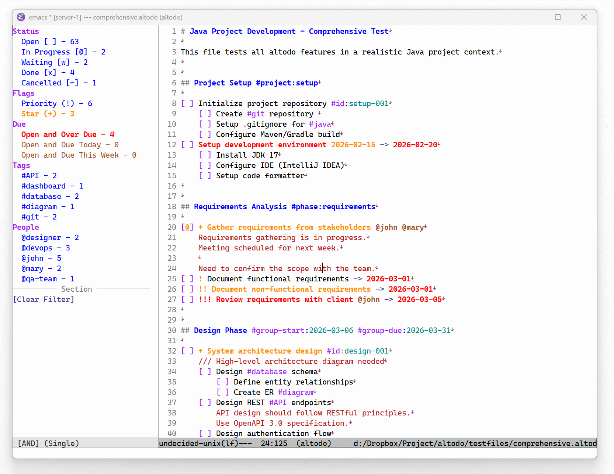

# altodo - TODO Text File Format and Emacs Major Mode Package

[日本語 README.md](README.md) / [Changelog](CHANGELOG_en.md)



This repository distributes the __altodo__ format specification and __altodo.el__, an Emacs Major Mode package for convenient TODO management.

- __altodo__ format: TODO format embeddable in Markdown (CommonMark) files
    - altodo format extensions are MIT licensed
- __altodo.el__: Emacs Lisp package for managing altodo format TODOs in Emacs
    - GNU General Public License v3.0 applies


## About altodo Format

__altodo__ is a custom extension of __Markdown__ and __CommonMark__ format specifications. altodo is based on and inspired by __[x]it!__ https://xit.jotaen.net/, which is licensed under Creative Commons CC0 1.0 Universal.

See doc/altodo_spec.md for details.

- Text format specification as custom extension of Markdown (CommonMark)
    - altodo format follows Markdown (CommonMark) specification except for altodo-specific syntax
- TODOs can be nested infinitely
- Single-line and multi-line comments supported
- Tags, stars, priority, start/due dates, and dependency tags supported

Its features are that TODOs can be embedded in Markdown, that it is plain text, that it nests without limit, and that it accepts multi-line comments. It is a simple TODO format that is readable even without editor support.


### Sample

```markdown
# altodo is a TODO format embeddable in Markdown

Regular Markdown (CommonMark) text can be placed before and after task lines.

[ ] TODO line starts here
[ ] Inline Markdown formatting like __bold__ ~~strikethrough~~ `code` works in tasks
[x] TODO line ends here

Non-task and non-comment lines are regular Markdown (CommonMark).


# Tags can be embedded in headings too #tag

## altodo File Example #tag

Below is an example of altodo format tasks.

[@] In-progress task
    /// Single-line comment
    [ ] Child task A (nest indent typically 4 spaces)
        [x] Completed child task
            [~] Cancelled task
    [w] Waiting task @JohnDoe is handling
[ ] + Starred task
    [ ] ! High priority task
        [ ] !! Higher priority task
            [ ] !!! Highest priority task
[ ] Task
    Multi-line comment line 1
    Multi-line comment line 2
    [ ] Nested task A
        Nested task A multi-line comment line 1
        Nested task A multi-line comment line 2
        
        A line with only the same indentation spaces also continues the comment (comment line 4)
[ ] Tagged task #home (space required before/after tag)
[ ] Task with start date 2025-01-01 -> starts from this date
    [ ] Task with due date -> 2025-12-31 must complete by this date
    [ ] Task with both dates 2025-02-01 -> 2025-03-31 within this period
[ ] Key-value tagged task #key:value
[ ] Task with ID tag (unique identifier) #id:20250101-0000
[ ] Task with dependency tag (references ID) #dep:20250101-0000
[ ] Dependent task 2 (references ID) #dep:20250101-0000
[ ] People @JohnDoe or places @home can be tagged with @person tags
```


### Main Syntax

#### Task Management

- `[ ]`: Open
- `[x]`: Done (auto-adds #done tag)
- `[@]`: In Progress
- `[w]`: Waiting
- `[~]`: Cancelled


#### Comments

- `/// comment`: Single-line comment. A detached note (a side remark, a review memo) that is not part of the task
- Multi-line comment: lines at the indent of the task/single-line comment above + 4 spaces. Part of the task, such as its description
    - The first line must be indented by exactly the previous line + 4 spaces. A line at the same indent or at + 8 spaces is not a multi-line comment
    - A completely empty line (zero characters) or a line with a different indent ends the comment


#### Flags

- `!`, `!!`, `!!!`: Priority (typically 3 levels, more `!` = higher priority)
- `+`: Star flag. It can be used with a priority (`+ !! Task`, `!! + Task`)
- Flags can also be added to single-line comments (`/// ! note`)


#### Tags

- `#tag`: General tag
- `#tag:value`: Key-value tag
- `@person`: Person/place tag (e.g., `@smith`, `@company`)


#### Special Tags

- `#id:value`: ID tag
- `#dep:value`: Dependency tag (references ID tag value)
- `#done:timestamp`: Time the task was completed or cancelled (added automatically by the application)
- `#seq-tasks`: Subtasks run from top to bottom (a task cannot start until the preceding sibling is completed or cancelled)
- `#group-start:date`, `#group-due:date`: put on a parent task, they give the start/due date of the whole group (the task and its descendants). Write them once on the parent, not on each subtask

Writing `#`, `@`, or `->` literally (escaping) is not supported at present (see section 3.7 of `doc/altodo_spec_en.md`).


#### Due/Start Dates

- `-> YYYY-MM-DD`: Due date
- `YYYY-MM-DD ->`: Start date
- `YYYY-MM-DD -> YYYY-MM-DD`: Start and due date


## altodo.el

Emacs Lisp package for managing altodo format TODOs in Emacs. Custom extension of __Emacs Markdown Mode__ https://github.com/jrblevin/markdown-mode, providing face highlighting, filtering, and other features for easy task viewing and manipulation.

See doc/design.md for details.

- Face highlighting of task states, flags, tags and dates, keybindings, and commands
- Sidebar with filters and the count of tasks that match each filter. When several filters are selected, the count is updated for the combination
    - Sidebar content is fully customizable

Speed is a priority: thousands of TODOs are supported. The design target for filtering is 1 second or less for a 5000-line buffer (measured with `scripts/bench-filter.sh`).
Filter conditions can be written as DSL patterns. Predicate functions are available when a lambda expression is used.


### Installation

- Emacs 29.1 or later (verified with Emacs 29.3 and markdown-mode 2.6)
- markdown-mode installed (`Package-Requires` says 2.0 or later; verified with 2.6)
    - Follow "Installation" in the [markdown-mode README](https://github.com/jrblevin/markdown-mode), which recommends MELPA Stable
    - `M-x package-install RET markdown-mode RET` (after adding MELPA Stable to the package archives)

```elisp
(require 'package)
(add-to-list 'package-archives
             '("melpa-stable" . "https://stable.melpa.org/packages/"))
(package-initialize)
```


Place altodo.el in any directory and add to init.el:

```
cp ./altodo.el ./altodo-calendar.el ~/.emacs.d/lisp/.
```

```elisp
(add-to-list 'load-path "~/.emacs.d/lisp/")
(require 'altodo)
(add-to-list 'auto-mode-alist '("\\.altodo\\'" . altodo-mode))
```


#### Getting Started

1. Create or open a `.altodo` file
2. Enable altodo-mode with `M-x altodo-mode`
3. Show sidebar with `M-x altodo-sidebar-show`
4. Manage tasks with keybindings


### Keybindings

altodo-mode inherits from markdown-mode, so markdown-mode keybindings are also available. Each altodo key is active only on certain lines. On any other line, the key keeps its markdown-mode binding.

- Task lines: the task operation keys, `C-c C-t d`, `C-c C-t D`
- Task lines and single-line comment lines: flag operations, date input, adding tasks, `C-c C-i`, `C-c C-j`
- Task lines, single-line comment lines and multi-line comment lines: `M-<right>`, `M-<left>`
- All lines: `TAB`, `RET`, `S-TAB`, the sidebar and filter keys (keys starting with `C-c C-v`)


#### Task Operations

- `C-c C-x`: Toggle task state (open `[ ]` ⇔ done `[x]`)
- `C-c C-t o`: Set to open
- `C-c C-t x`: Set to done
- `C-c C-t @`: Set to in-progress
- `C-c C-t w`: Set to waiting
- `C-c C-t ~`: Set to cancelled


#### Flag Operations

- `C-c C-s`: Toggle star flag
- `C-c C-f 1`: Set priority 1
- `C-c C-f 2`: Set priority 2
- `C-c C-f 3`: Set priority 3
- `C-c C-i`: Insert ID tag (`#id:value` format)


#### Date Input

Enter the due date (`-> DATE`) or the start date (`DATE ->`) on the task line (or `///` line) at the cursor. The date is written in `altodo-date-format`. An existing date of the same kind is replaced.

- `C-c C-e d`: Select the due date in a calendar window (`altodo-select-due-calendar`)
- `C-c C-e s`: Select the start date in a calendar window (`altodo-select-start-calendar`)
- `M-x altodo-input-due-date`: Enter the due date in the minibuffer
- `M-x altodo-input-start-date`: Enter the start date in the minibuffer

In the calendar window, move to a date and press `RET` to set it, or `q` to cancel. The week starts on `altodo-week-start-day`. The cursor starts at the date already on the line. If both dates exist, they share the arrow, as in `DATE -> DATE`.


#### Adding Tasks

- `RET`: Context-aware newline
- `C-c C-a`: Add a task
- `M-RET`: Add a subtask
- `C-c C-m`: Start a multi-line comment


#### Indent (Nesting) Operations

- `TAB`: Smart indent
- `M-<right>`: Increase indent
- `M-<left>`: Decrease indent


#### Other

- `S-TAB`: Outline cycle
- `C-c C-t d`: Move done task to done file (with its descendants)
- `C-c C-t D`: Move only the done task line to done file (subtasks stay)
- `C-c C-j`: Jump to dependency (`#dep:xxx` → `#id:xxx`)
- `M-x altodo-sidebar-show`: Show sidebar
- `M-x altodo-sidebar-hide`: Hide sidebar
- `M-x altodo-sidebar-toggle`: Toggle sidebar
- `C-c C-v s t`: Toggle sidebar
- `C-c C-v s r`: Refresh sidebar
- `C-c C-v f c`: Clear filter


#### Sidebar Operations (within sidebar)

- `RET`, `SPC`: Apply filter
- `s`: Select/deselect filter (multiple selection)
- `c`: Clear filter
- `r`: Refresh sidebar
- `q`: Close sidebar
- `?`, `h`: Show the key bindings
- `}`, `{`, `.`: Calendar: next month, previous month, this month
- `n`, `p`: Move to next/previous line
- `C-c C-a`: Switch to AND mode
- `C-c C-o`: Switch to OR mode
- `C-c C-t`: Toggle AND/OR
- `Ctrl+mouse-left`: Select/deselect filter with mouse


### Done Task Move Feature

Automatically move completed (`[x]`) or cancelled (`[~]`) tasks to separate file. By default, a task is moved together with its descendants (subtasks, `///` lines and multi-line comments) as a subtree, grouped by heading.


#### Basic Features

- Manual move: `C-c C-t d` moves the task at the cursor with its descendants
- Move one task: `C-c C-t D` moves only the line of the task at the cursor (and its multi-line comments). Subtasks stay where they are
- Batch move: `M-x altodo-move-all-done-tasks` moves all done tasks in buffer
- Auto-move timer: Periodically moves done tasks from all buffers


#### Unit of the Move

`altodo-move-unit` chooses the unit of the move.

- `subtree` (default): A done or cancelled task is moved with its descendants. If a descendant is not done, nothing is moved (an error by hand; skipped by the batch and automatic moves). The batch move and the automatic move handle only tasks without a parent. A done subtask waits until its parent is done and the whole subtree is done. The manual move (`C-c C-t d`) can move the subtree of a subtask even if its parent is not done
- `line`: Only the task line and its multi-line comments are moved. Subtasks stay where they are, and a done subtask leaves its parent

In the done file, the root of the moved subtree is written with indent 0, and the relative indent of the descendants is kept. `C-c C-t D` (`M-x altodo-move-done-task-alone`) moves in the `line` unit whatever `altodo-move-unit` is.


#### Days Before the Move

If `altodo-move-after-days` is a number N, the batch move (`M-x altodo-move-all-done-tasks`) and the automatic move take only tasks whose `#done` date is N or more days ago. The manual move (`C-c C-t d`, `C-c C-t D`) is not affected.

- The `#done` value is read as an ISO 8601 date or time (the date part is used), a Unix time in seconds, or a date in `altodo-date-format`
- A task without a `#done` tag, or with a value that is not a date, is not moved
- Time zone: the date of `#done` is the date in the time zone of the time that was written. Today's date is counted in the local time zone. If `altodo-use-local-timezone` is `nil` (recorded in UTC), the date of `#done` can differ from the local date by up to one day, so the judgment of N days can be off by up to one day. The UTC offset (such as `+09:00`) of an ISO 8601 value is not used for the judgment
- With the unit `subtree`, every task of the subtree must meet the condition. With `line`, only that task is checked


#### Done File

- Done tasks move to `{original-filename}_done.altodo`
- Grouped by heading (section)
- Multi-line comments move with task
- Blank lines preserved
- Nothing is moved, and an error is signaled, if the buffer is read-only or the done file cannot be written (it is a directory, or its parent directory is not writable)
- If a buffer visits the done file, the task is appended to that buffer. The buffer is saved if it had no unsaved changes; otherwise it is not saved and a message says so
- In the automatic move, if the move fails in one buffer, a message is shown and the other buffers are still moved. A read-only buffer is not moved, and a message is shown


#### Auto-move Timer

```elisp
;; Toggle timer start/stop
M-x altodo-toggle-auto-move-timer

;; Or individually
M-x altodo-start-auto-move-timer
M-x altodo-stop-auto-move-timer

;; Change execution interval (default: 3600 seconds = 1 hour; a positive number)
(setq altodo-auto-move-interval 1800)  ; 30 minutes

;; Enable auto-save after move (default: nil)
(setq altodo-auto-save-after-move t)

;; Move only tasks whose #done date is 7 or more days ago (default: nil = move at once)
(setq altodo-move-after-days 7)

;; Skip done files (default: t)
(setq altodo-auto-move-skip-done-files t)

;; Show in mode line (default: t)
(setq altodo-show-auto-move-in-mode-line t)
```


#### Done File Customization

```elisp
;; Change done file suffix (default: "_done")
(setq altodo-done-file-prefix "_archive")
```


### Configuration

#### Basic Settings

| Variable                                       | Description                                       | Default |
| ---------------------------------------------- | ------------------------------------------------- | ------- |
| `altodo-indent-size`                           | Indent size (spaces)                              | `4`     |
| `altodo-enable-markdown-in-multiline-comments` | Enable Markdown formatting in multi-line comments | `t`     |
| `altodo-auto-save`                             | Auto-save file on task state change               | `nil`   |
| `altodo-skk-wrap-newline`                      | Wrap newline for SKK input method compatibility   | `t`     |


#### Sidebar Settings

| Variable                                | Description                                               | Default |
| --------------------------------------- | --------------------------------------------------------- | ------- |
| `altodo-sidebar-modeline-enabled`       | Show filter state in sidebar mode line                    | `t`     |
| `altodo-sidebar-dynamic-count-enabled`  | Dynamically update count with multiple filters            | `t`     |
| `altodo-sidebar-position`               | Sidebar position (`left` or `right`)                      | `'left` |
| `altodo-sidebar-size`                   | Sidebar width (window ratio 0.0-1.0)                      | `0.2`   |
| `altodo-sidebar-indent`                 | Sidebar indent width                                      | `2`     |
| `altodo-sidebar-focus-after-activation` | Move focus to the source window after a filter is applied | `nil`   |
| `altodo-sidebar-hide-mode-line`         | Hide sidebar mode line                                    | `nil`   |
| `altodo-sidebar-hide-line-numbers`      | Hide sidebar line numbers                                 | `t`     |
| `altodo-locals-code-policy`             | Policy for code in `.altodo-locals.el`                    | `'deny` |
| `altodo-trusted-locals`                 | SHA-256 of trusted `.altodo-locals.el` files              | `nil`   |


#### Date/ID Settings

| Variable                          | Description                         | Default        |
| --------------------------------- | ----------------------------------- | -------------- |
| `altodo-date-format`              | Date format (nil for ISO 8601)      | `nil`          |
| `altodo-week-start-day`           | Week start day (0=Sunday, 1=Monday) | `0`            |
| `altodo-done-tag-datetime-format` | #done tag timestamp format          | `nil`          |
| `altodo-use-local-timezone`       | Use local timezone in #done tag     | `t`            |
| `altodo-insert-id-format`         | #id: tag ID format                  | `'tiny-random` |


##### `altodo-date-format`

Date display format. `nil` uses ISO 8601 format (`YYYY-MM-DD`).

**Examples**:
```elisp
(setq altodo-date-format "%Y/%m/%d")      ;; 2026/01/15
(setq altodo-date-format "%Y-%m-%d")      ;; 2026-01-15
(setq altodo-date-format nil)             ;; 2026-01-15 (ISO 8601)
```


##### `altodo-done-tag-datetime-format`

`#done:TIMESTAMP` tag timestamp format. `nil` uses ISO 8601 format (`YYYY-MM-DDTHH:MM:SS+HH:MM`).

**Examples**:
```elisp
(setq altodo-done-tag-datetime-format "%Y-%m-%d %H:%M:%S")  ;; 2026-01-15 14:30:00
(setq altodo-done-tag-datetime-format nil)                  ;; 2026-01-15T14:30:00+09:00
```


##### `altodo-insert-id-format`

ID tag format for `C-c C-i` insertion.

**Options**:
- `'tiny-random`: up to 10 characters, random part first (default; leading zeros are dropped, so 8 to 10 characters)
- `'tiny`: 10 characters, timestamp part first (sortable by time)
- `'short-random`: up to 16 characters, random part first (14 to 16 characters)
- `'short`: 15 characters, timestamp part first (sortable by time)
- `'base62`: 21 characters, UUID v7 written in Base62
- `'uuid`: 36 characters, UUID v7 (RFC 9562; the first 48 bits are the Unix time in milliseconds)

**Examples**:
```elisp
(setq altodo-insert-id-format 'tiny-random)      ;; 6WJT2C47gz
(setq altodo-insert-id-format 'tiny)             ;; 2C47gz6WJT
(setq altodo-insert-id-format 'uuid)             ;; 01a167b2-1ffe-76ae-900f-81590d270596
```


#### Task Move Settings

| Variable                             | Description                                  | Default   |
| ------------------------------------ | -------------------------------------------- | --------- |
| `altodo-done-file-prefix`            | Done file prefix                             | `"_done"` |
| `altodo-move-unit`                   | Unit of the move (`subtree` or `line`)       | `subtree` |
| `altodo-auto-move-interval`          | Auto-move execution interval (seconds)       | `3600`    |
| `altodo-move-after-days`             | Days from #done to the move (`nil`: at once) | `nil`     |
| `altodo-auto-save-after-move`        | Auto-save after move                         | `nil`     |
| `altodo-auto-move-skip-done-files`   | Skip done files                              | `t`       |
| `altodo-show-auto-move-in-mode-line` | Show auto-move state in mode line            | `t`       |


#### Investigation Commands

The commands that find out why altodo behaves as it does are in a separate file, `altodo-debug.el` (altodo itself does not load it; use `(require 'altodo-debug)`). They are `M-x altodo-debug-describe-line` (diagnose a line), `altodo-debug-explain-pattern` (diagnose a DSL pattern), `altodo-debug-trace` (trace a function), `altodo-debug-profile` (measure the performance), and `altodo-debug-report` (the information for a bug report). In batch mode, `scripts/debug-line.sh FILE LINE` and `scripts/debug-pattern.sh FILE PATTERN` run them. See `doc/debug_en.md`.


#### Default Filter Settings

| Variable                         | Description                     | Default   |
| -------------------------------- | ------------------------------- | --------- |
| `altodo-default-filter-patterns` | Default sidebar filter patterns | See below |

```elisp
;; Default filter configuration example
(setq altodo-default-filter-patterns
  '((:title "" :type calendar :nest 1)
    (:title "Status" :type group-header :nest 0)
    (:title "Open [ ] - %n" :type search-simple :pattern "open" :count-format t :nest 1)
    (:title "In Progress [@] - %n" :type search-simple :pattern "progress" :count-format t :nest 1)
    (:title "Waiting [w] - %n" :type search-simple :pattern "waiting" :count-format t :nest 1)
    (:title "Done [x] - %n" :type search-simple :pattern "done" :count-format t :nest 1)
    (:title "Cancelled [~] - %n" :type search-simple :pattern "cancelled" :count-format t :nest 1)
    (:title "Flags" :type group-header :nest 0)
    (:title "Priority (!) - %n" :type search-simple :pattern "priority" :count-format t :nest 1)
    (:title "Star (+) - %n" :type search-simple :pattern "star" :count-format t :nest 1)
    (:title "Due" :type group-header :nest 0)
    (:title "Open and Over Due - %n"
            :type search-simple
            :pattern "and:due-date:overdue,not:state-any:done|cancelled"
            :count-format t :nest 1
            :face altodo-sidebar-search-lambda-face
            :face-rules ((>= 1 error)))
    (:title "Open and Due Today - %n"
            :type search-simple
            :pattern "and:due-date:today,not:state-any:done|cancelled"
            :count-format t :nest 1
            :face altodo-sidebar-search-lambda-face
            :face-rules ((>= 1 error)))
    (:title "Open and Due This Week - %n"
            :type search-simple
            :pattern "and:due-date:this-week,not:due-date:today,not:state-any:done|cancelled"
            :count-format t :nest 1
            :face altodo-sidebar-search-lambda-face)
    (:title "Tags" :type group-header :nest 0)
    (:title "#%s - %n" :type dynamic :dynamic-type "tag" :count-format t :limit 5 :nest 1
            :exclude-tag ("id" "dep" "done") :tag-mode "name-only")
    (:title "People" :type group-header :nest 0)
    (:title "@%s - %n" :type dynamic :dynamic-type "person" :count-format t :limit 5 :nest 1)
    (:title "Headings" :type group-header :nest 0)
    (:title "%s - %n" :type dynamic :dynamic-type "heading" :count-format t :nest 1)
    (:title "Section" :type separator :pattern "─" :nest 0)
    (:title "[Clear Filter]" :type command :nest 0 :command altodo-filter-clear)))
```


#### Code in the Configuration File (`.altodo-locals.el`)

A `.altodo-locals.el` in the same directory as an altodo file changes the sidebar filter patterns and other settings of that directory (see section 4 of `doc/design_en.md` for the format). The following code in this file does not run by default. This prevents unintended code from running when the file comes from a directory received from someone else.

- The `:pattern` (lambda) of `:type search-lambda`, and `:count-pattern-lambda`
- A `:command` whose name does not start with altodo- (commands such as `altodo-filter-clear` always run)

A minimal configuration file (`search-simple` has no code, so it works as it is):

```elisp
((altodo-filter-patterns .
  ((:title "Open - %n" :type search-simple :pattern "open" :count-format t)
   (:title "Done - %n" :type search-simple :pattern "done" :count-format t)))
 (altodo-sidebar-position . right))
```

Entries whose code does not run are still shown in the sidebar. The count is shown as `?`, and selecting such an entry shows a message that the code does not run.

Choose the policy with `altodo-locals-code-policy`.

| Value     | Behavior                                                                                  |
| --------- | ----------------------------------------------------------------------------------------- |
| `deny`    | Default. The code does not run                                                            |
| `confirm` | Asks when you select an entry whether to trust the file (SHA-256). Only trusted files run |
| `allow`   | Always runs. Use only in directories you trust                                            |

Trusting a file under `confirm` saves its path and SHA-256 to `altodo-trusted-locals`. Changing the content of the file ends the trust, and you are asked again. Code in `altodo-default-filter-patterns` (the Emacs configuration) always runs.

```elisp
;; Run the code in the configuration file only for trusted files
(setq altodo-locals-code-policy 'confirm)
```


#### Calendar and Agenda

The `calendar` is the first entry of the default patterns (`altodo-default-filter-patterns`). Add `calendar` and `agenda` entries to `altodo-filter-patterns` (`.altodo-locals.el` or `altodo-default-filter-patterns`) to show a month calendar and a list by day in the sidebar. They show the number of unfinished tasks that have a due date (`-> DATE`) or a start date (`DATE ->`).

```elisp
(:title "" :type calendar :nest 1)
(:title "Next 7 days" :type agenda :days 7 :nest 1)
```


##### Calendar (`calendar`)

- A month table. The face of a day cell changes with the tasks of the day. Selecting a day with tasks filters by the tasks of that day
- Saturdays are blue, and Sundays and holidays are red. The holidays are the Japanese national holidays by default (see below). Today has a background (the selection color)
- A day with due dates has a red background. An unfinished due date in the past is also bold and underlined. A day with `altodo-calendar-heavy-count` (default 3) or more due dates has a yellow background
- A day with start dates has a blue background
- If a day has both due and start dates, the side of `altodo-calendar-priority` (`due` or `start`; default `due`) decides the face and the filter that selecting the day applies
- Done and cancelled tasks, and dates that do not exist, are not counted (`:count-done t` also counts done and cancelled tasks)
- The buttons `<` and `>` on the first line move the month, and the month name returns to this month. In the sidebar you can also use `}` (next month), `{` (previous month) and `.` (this month)
- It needs width (20 columns with the default weekday names, plus the indent). If the sidebar window is narrower, a note is shown. The week starts on `altodo-week-start-day`

Properties of the entry: `:title`, `:nest`, `:calendar-target` (`due`, `start` or `both`; default `both`), `:count-done`.


##### List by day (`agenda`)

- Shows `:days` days from today (default 7), one line per day. `D` is the number of tasks with a due date and `S` with a start date. Selecting a day with tasks filters by the tasks of that day (only the side of `altodo-calendar-priority` if the day has both)
- The "Overdue" line shows the number of overdue tasks; selecting it filters by overdue tasks
- The display is set with the properties of the entry (`altodo-filter-patterns`; there are no separate option variables)
    - `:date-format`: format of the date. `altodo` (default; same as `altodo-date-format`), `done-tag` (same as `altodo-done-tag-datetime-format`), or a format string such as `"%m/%d"`
    - `:show-weekday`: `nil` hides the weekday (default `t`). The weekday name is taken from `altodo-calendar-day-names` when it is changed from the default; otherwise it is the three-letter abbreviation of the language of Emacs (such as `Tue`)
    - `:today-label`, `:tomorrow-label`, `:overdue-label`: the strings "Today", "Tomorrow" and "Overdue"
    - `:label-newline`: `t` puts a label on a line of its own, with the date and counts on the next line (default `nil`)
    - `:agenda-overdue`: `nil` hides the overdue line

Example of a list:

```elisp
(:title "Soon" :type agenda :days 5 :date-format "%m/%d"
 :today-label "Now" :tomorrow-label "Next" :overdue-label "Late"
 :label-newline t :nest 1)
```


##### Display options

The mini calendar itself is in a separate file, `altodo-calendar.el` (feature `altodo-calendar`), and can be used by other packages (`altodo-calendar-insert`). Change the options below with `M-x customize-group RET altodo-calendar RET`.

- `altodo-calendar-day-names`: Names of the weekdays (7, from Sunday). All columns are as wide as the widest name (default: `["Su" "Mo" … "Sa"]`)
- `altodo-calendar-day-name-faces`: Faces of the weekday names (7, from Sunday) (default: red Sunday, blue Saturday)
- `altodo-calendar-month-names`: Names of the months (12, from January) (default: English names)
- `altodo-calendar-title-format`: Format of the title (month name, then year). `"%2$d, %1$s"` puts the year first (default: `"%s %d"`)
- `altodo-calendar-show-nav`: Show `<` and `>` (with `nil` the month name is still a button to this month) (default: `t`)
- `altodo-calendar-holiday-function`: Function that returns the holiday name of a date. `nil`: no holidays (default: Japanese national holidays)
- `altodo-calendar-heavy-count`: Number of due dates for the heavy (yellow) day (default: `3`)
- `altodo-calendar-priority`: Side that wins when a day has both dates (`due` or `start`) (default: `due`)

Example for Japanese names:

```elisp
(setq altodo-calendar-day-names ["日" "月" "火" "水" "木" "金" "土"]
      altodo-calendar-month-names ["1月" "2月" "3月" "4月" "5月" "6月"
                                   "7月" "8月" "9月" "10月" "11月" "12月"]
      altodo-calendar-title-format "%2$d年 %1$s")
```

For the holiday function, give `altodo-calendar-japanese-holiday` (default), `altodo-calendar-emacs-holiday` (uses `calendar-holidays` of Emacs), or your own function that takes `(MONTH DAY YEAR)` and returns the name of the holiday or `nil`. The Japanese holidays follow the law on national holidays (in force since 1948). The vernal and autumnal equinox holidays use an approximation formula and exist only for 1980 to 2099.


##### Faces

The faces are defined by inheriting existing faces, and can be changed with `customize-face`. From the highest precedence:

- `altodo-calendar-selected-face`: The day being filtered (inherits `highlight`; bold and underlined)
- `altodo-calendar-overdue-face`: An unfinished due date in the past (bold, underlined; no background)
- `altodo-calendar-due-heavy-face`: A day with many due dates (inherits `warning`, used as the background)
- `altodo-calendar-due-face`: A day with due dates (inherits `error`, used as the background)
- `altodo-calendar-start-face`: A day with start dates (inherits `font-lock-function-name-face`, background)
- `altodo-calendar-today-face`: Today (inherits `region`; also has a box)
- `altodo-calendar-holiday-face`: Holidays (inherits `altodo-calendar-sunday-face`)
- `altodo-calendar-sunday-face`, `-saturday-face`: Sunday (`error`) and Saturday (`font-lock-function-name-face`)
- `altodo-calendar-day-face`: Other days
- `altodo-calendar-header-face`, `-nav-face`, `-weekday-face`: Title, `<` and `>`, and the names of Monday to Friday
- `altodo-agenda-overdue-face`, `-today-face`, `-empty-face`, `-date-face`, `-count-face`: The lines of the list


#### Heading Jump

`:dynamic-type "heading"` of `:type dynamic` lists the headings of the buffer in buffer order. Selecting a heading (`RET`, click) does not change the filter. It moves point to the heading line in the source buffer and shows that line near the top of the window. If a filter hides the heading line, the filter is cleared first. ATX headings (`#`) and Setext headings (`===`, `---`) are listed; lines in a code block are not.

```elisp
(:title "%s - %n" :type dynamic :dynamic-type "heading"
        :level (1 2) :limit 20 :indent-by-level 2 :count-format t :nest 1)
```

- `:title`: `%s` is the heading text, `%l` the level (1 or more), and `%n` the number of unfinished tasks (neither done nor cancelled, including nested ones) from the heading to the next heading of any level. `%n` is counted only when `:count-format` is not `nil` and `:title` contains `%n`
- `:level`: levels to list. An integer or a list of integers such as `(1 2)`. All levels if omitted
- `:limit`: maximum number of headings, counted from the top of the buffer. `0` or `nil` (default) means unlimited
- `:indent-by-level`: indent by heading level. `t` (default) does not indent level 1 and indents one more step (`altodo-sidebar-indent`) per deeper level. An integer N does not indent levels up to N and indents a deeper heading by (level - N) steps (with `2`, `# aa` and `## aa` are at the same position and `### aa` is one step deeper). `nil` does not indent by level. An integer below 1 is the same as `t`. `:nest` is added to these steps
- `:face`, `:face-count`, `:nest`: same as the other dynamic filters
- `:sort`, `:exclude-*`, `:tag-mode`: not used for headings (ignored)
- Multiple selection (`s`) is not available
- The list of headings is built each time the sidebar is drawn. If the buffer is edited after that and the heading is gone, selecting the entry does not move point and shows a message


#### Configuration Examples

```elisp
;; Use the date format "2026/01/15"
(setq altodo-date-format "%Y/%m/%d")

;; Show the sidebar on the right
(setq altodo-sidebar-position 'right)

;; Auto-move every 30 minutes and save after the move
(setq altodo-auto-move-interval 1800
      altodo-auto-save-after-move t)
```
